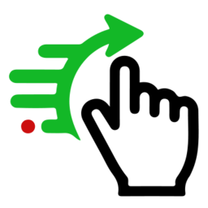
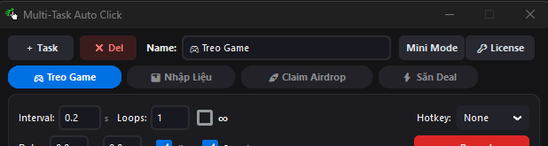
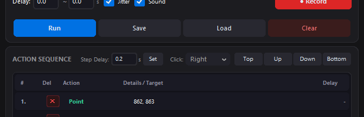
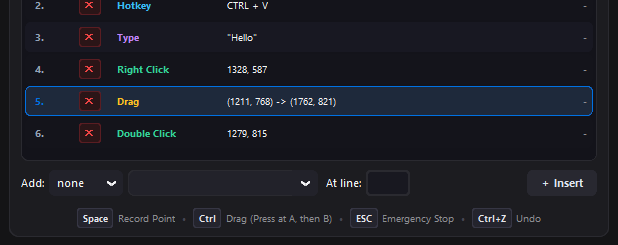

  

<h1 align="center">Human-Simulated Desktop Automation Studio</h1>

  <strong>Undetectable, High-Precision Windows Automation with Micro-Jitter, Gaussian Delays, and Concurrent Multi-Tab Workflows.</strong>

  
  

  
  
  
  

---

## ⚡ Why Traditional Auto-Clickers Get You Banned

Whether you are farming Web3 airdrops across anti-detect browsers (AdsPower, GoLogin), multi-boxing MMO games, or automating desktop data workflows, standard auto-clickers (OP Auto Clicker, AutoHotkey tight loops) get detected by modern **Behavioral Telemetry**:

1. **Absolute Coordinate Lock**: Firing repetitive clicks at the exact integer coordinate $(X, Y)$ triggers heuristic bot detection.
2. **Zero Millisecond Variance**: Mechanical timers (e.g., clicking every exact 1000ms) are easily clustered and flagged by anti-Sybil algorithms.
3. **Contention & Thread Freezes**: Unthrottled macro loops freeze the OS event dispatch queue, exposing unnatural thread activity.

**Human-Simulated Desktop Automation Studio** was built from the ground up to solve these exact vulnerabilities.

---

## ✨ Key Features

### 🎯 Hardware Micro-Jitter ($\pm 2\text{px}$)
Simulates the physiological micro-movements of human hands. Each action applies subtle randomized offset trajectories around the target coordinate center, passing sub-pixel behavioral audits.

### ⏱️ Gaussian Randomized Delays
Configurable non-linear pause intervals ($X \pm \Delta t$). Break static rhythms and emulate natural human reaction latency.

### 🗂️ Concurrent Multi-Tab Execution
Run independent automation loops simultaneously across multi-screen setups, anti-detect browser windows, and game emulators without thread blocking.

### 🛑 50ms Emergency Killswitch (`ESC`)
Safety-first design. Hit `ESC` at any millisecond to immediately terminate all active threads and release stuck mouse buttons.

### 🔒 100% Offline & Local Privacy
- Zero cloud syncing
- Zero telemetry tracking
- No wallet or credential data ever leaves your local Windows machine.

---

## 📊 Comparison Matrix

| Feature | Standard Clickers (OP, AHK) | Cloud RPA Tools | **Human-Simulated Studio** |
| :--- | :---: | :---: | :---: |
| **Micro-Jitter Deviation** | ❌ Static coordinates | ⚠️ Synthetic | ✅ **Natural ($\pm 2\text{px}$)** |
| **Gaussian Interval Randomization** | ❌ Rigid static delays | ⚠️ Limited | ✅ **Configurable $X \pm \Delta t$** |
| **Multi-Tab Concurrency** | ❌ Single thread only | ⚠️ High monthly cost | ✅ **Built-in multi-threaded** |
| **Emergency Safety Killswitch** | ⚠️ Often freezes OS | ❌ Latency lag | ✅ **50ms Hardware Killswitch** |
| **Local Privacy Guarantee** | ✅ Local | ❌ Transmits to Cloud | ✅ **100% Local Offline** |
| **Pricing Model** | Free (High Ban Risk) | \$50 - \$200/month | **\$29 Lifetime / Free Trial** |

---

## 🖥️ User Interface Preview

| Multi-Tab Workflows | Granular Human Controls | Action Sequencing |
| :---: | :---: | :---: |
|  |  |  |

---

## 📥 Download & Installation

1. Head to the official website: [https://multitasksautoclick.nimbokit.com](https://multitasksautoclick.nimbokit.com) (or check [Releases](https://github.com/dukamer/human-simulated-desktop-automation/releases)).
2. Download `MultiTaskAutoClick_Setup.exe`.
3. Run the installer and launch the Studio.
4. Enjoy safe, undetectable automation with the free trial mode!

---

## 🛡️ Antivirus & Security Notice

- Built with modern Python and packaged as a standalone Windows 64-bit native executable.
- The software communicates solely with the local OS input dispatcher and requires no administrator rights or invasive kernel drivers.

---

## 📬 Support & Feedback

- **Official Website**: [multitasksautoclick.nimbokit.com](https://multitasksautoclick.nimbokit.com)
- **Bug Reports & Feature Requests**: Please open an issue in the [GitHub Issues](https://github.com/dukamer/human-simulated-desktop-automation/issues) section.

---

  © 2026 Human-Simulated Desktop Automation Studio. All rights reserved.

